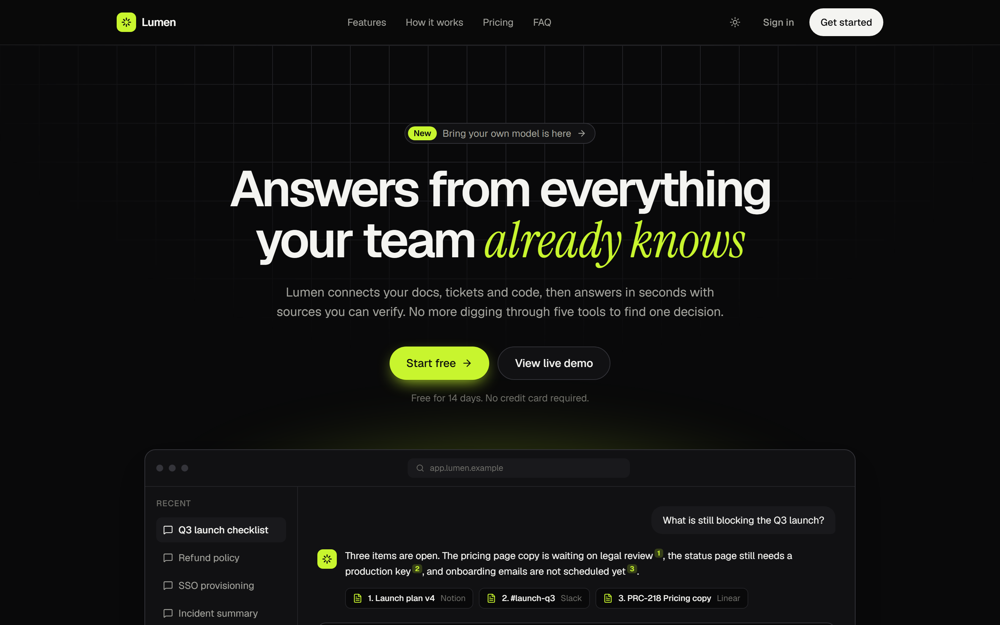
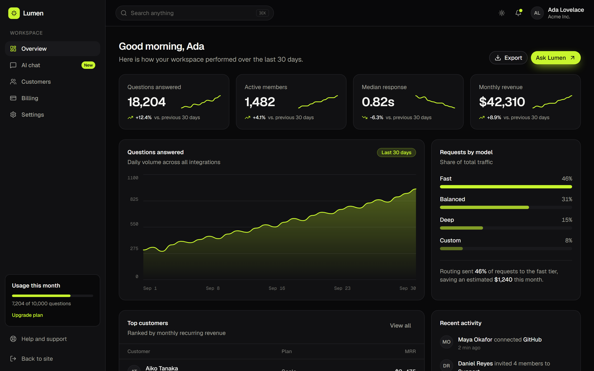
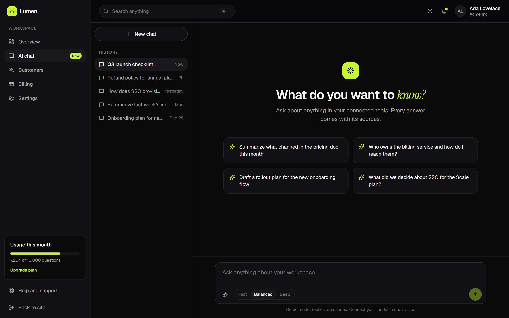
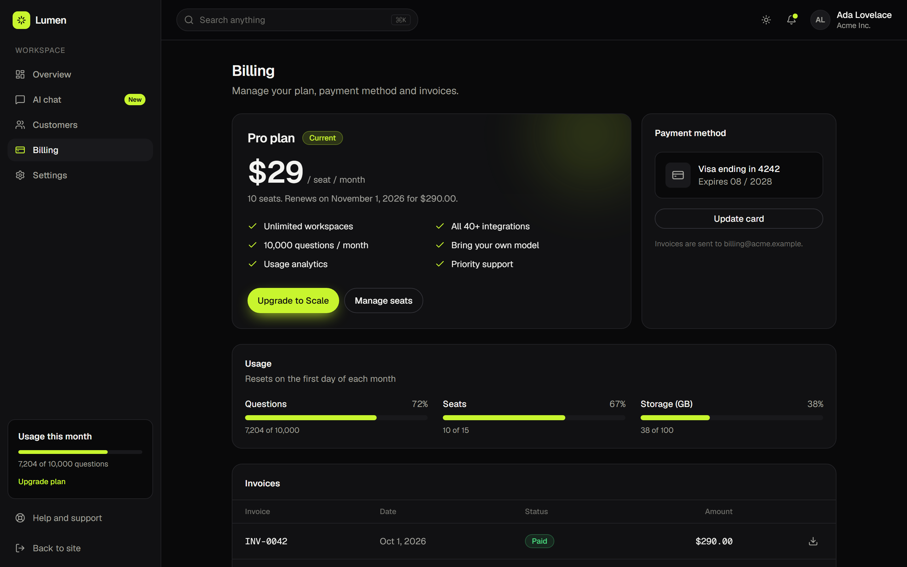
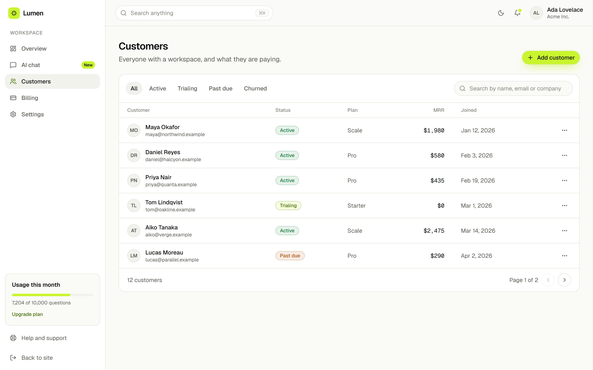

# Lumen Lite

A free, open-source landing page for AI SaaS products.
Built with Next.js 16, React 19, Tailwind CSS 4 and TypeScript.



**[Live demo](https://lumen-eight-bice.vercel.app)** · **[Get the full kit](https://vigranpitak.gumroad.com/l/lumen-ai-saas-kit)**

## What's included

- Hero with an animated product preview
- Logo marquee
- Feature grid
- How-it-works steps and stats
- Testimonials
- Pricing table with a monthly / yearly toggle
- FAQ and a closing call to action
- Responsive navbar and footer
- Light and dark themes with no flash on load

Everything is statically prerendered, and the only dependencies beyond Next.js are Lucide icons and tailwind-merge.

## Getting started

Requires Node.js 20.9 or newer.

```bash
git clone https://github.com/vigransamerpitak/lumen-lite.git
cd lumen-lite
npm install
npm run dev
```

Open http://localhost:3000.

## Make it yours

- **Copy:** all text, pricing plans and FAQs live in `src/lib/site.ts`.
- **Colors:** every color is a CSS variable at the top of `src/app/globals.css`. Change `--accent`, `--accent-fg` and `--accent-text` to rebrand.
- **Fonts:** loaded in `src/app/layout.tsx` with `next/font`.
- **Sections:** reorder or remove them in `src/app/(marketing)/page.tsx`.

## Need the app behind the landing page?

Lumen Lite is the landing page from **[Lumen, the full AI SaaS starter kit](https://vigranpitak.gumroad.com/l/lumen-ai-saas-kit)**.
The full kit adds everything that comes after the "Sign in" button, in the same design system, so the
changes you make here carry straight over.

| | Lumen Lite (free) | Lumen (full kit) |
| --- | :---: | :---: |
| Landing page | ✓ | ✓ |
| Light and dark themes | ✓ | ✓ |
| Dashboard with KPI cards and interactive charts | | ✓ |
| AI chat with streaming UI, stop button and model picker | | ✓ |
| Customers table with search, filters and pagination | | ✓ |
| Billing page with plan, usage and invoices | | ✓ |
| Settings with profile, notifications and API keys | | ✓ |
| Sign in, sign up and reset password screens | | ✓ |
| Step-by-step user guide (English and Thai) | | ✓ |

### Dashboard



### AI chat



### Billing



### Customers



Try every page in the **[live demo](https://lumen-eight-bice.vercel.app/dashboard)**, then
**[get the full kit on Gumroad](https://vigranpitak.gumroad.com/l/lumen-ai-saas-kit)**.

The full kit is a front-end kit: the chat runs on sample replies and the auth screens are interface
only, so you connect your own model and auth provider. The included guide shows where.

## License

MIT. Use it for anything, including commercial projects. See `LICENSE.md`.

The full Lumen kit is sold under a separate commercial license.
